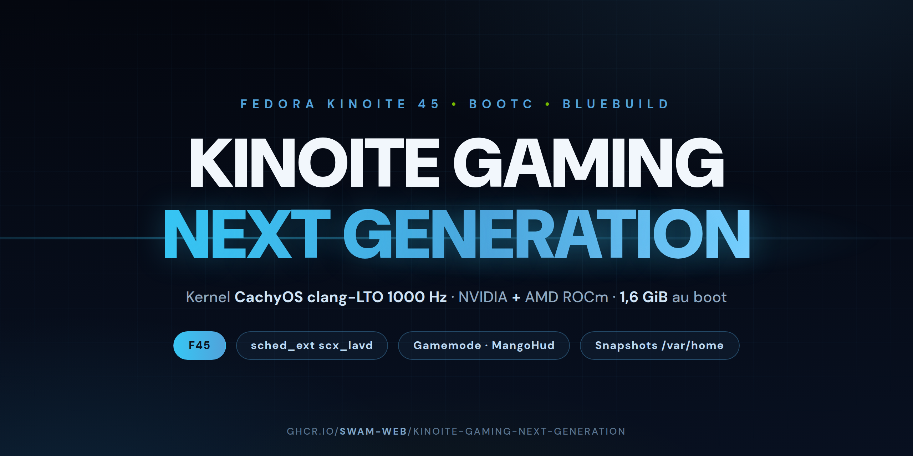

# Kinoite-Gaming-Next-Generation

Image **bootc** (Fedora Atomic) **universelle** basée sur **Kinoite 45**
(`quay.io/fedora-ostree-desktops/kinoite:45`), construite avec
[BlueBuild](https://blue-build.org/). Génération suivante de
`swam-os-kinoite-gaming` : même socle, base F45.

**Identité** : Fedora/Kinoite d'origine — le rebadge SwamOS (os-release, SDDM,
fastfetch) a été reverté (commit `c4790e1`).

- **Base** : `quay.io/fedora-ostree-desktops/kinoite` version `45`
- **Image publiée** : `ghcr.io/swam-web/kinoite-gaming-next-generation:latest`
- **Statut base F45** : GA prévue le **27/10/2026** (reportée du 20/10) — d'ici là,
  le tag `:45` pointe sur les composes de final freeze. Le COPR CachyOS build
  déjà pour `fedora-45-x86_64` ✓

## Pourquoi une image universelle

| Matériel | Ce qui se passe |
|---|---|
| NVIDIA | `nvidia.ko` (akmod compilé clang) se charge, `nouveau` blackisté ; ROCm présent mais inerte |
| AMD | `amdgpu` in-tree (kernel CachyOS) se charge ; la pile NVIDIA est inerte |
| Laptop hybride (iGPU AMD + dGPU NVIDIA) | Les deux se chargent et coopèrent — cas impossible avec deux images séparées |

## Contenu

| | Détail |
|---|---|
| **Kernel** | CachyOS `kernel-cachyos-lto` (Clang LTO, 1000 Hz, full preempt) — COPR `bieszczaders/kernel-cachyos-lto`, remplace le kernel Fedora (pattern `install-kernel-akmods`) |
| **NVIDIA (RPMFusion)** | `akmod-nvidia` + userland `xorg-x11-drv-nvidia` (`.i686` inclus), kmods recompilés **clang** contre le kernel CachyOS (`pahole` + `xorg-x11-drv-nvidia-kmodsrc`) |
| **AMD ROCm (minimal gaming)** | Dépôt officiel AMD (RHEL9) : `rocm-core`, `rocm-opencl-runtime`, `rocm-smi` — installé via l'optfix BlueBuild (`/usr/lib/opt`, symlinks `/opt` au boot). **Sans la pile HIP** (`rocm-hip-runtime`, `rocm-libs`/rocBLAS ≈ 5-6 Go) : inutile aux jeux (Vulkan/DXVK via mesa) — qui en a besoin : `rpm-ostree install rocm-hip-runtime rocm-libs` |
| **WiFi/BT MT7927** | `mt7925e`/`mt76` + `btusb`/`btmtk` précompilés (jetm/mediatek-mt7927-dkms v2.16, clang) contre le kernel CachyOS ; firmware BT `MT6639` embarqué (absent de linux-firmware) |
| **Codecs universels** | RPMFusion : ffmpeg complet, `@multimedia`, openh264, libdvdcss ; VA-API/Vulkan **AMD** (`mesa-*-freeworld`) **et** pont NVDEC→VA-API **NVIDIA** (`libva-nvidia-driver`) ; 32 bits complets |
| **Gaming** | gamescope, gamemode, mangohud, vkBasalt, goverlay, steam-devices (RPM) ; Steam, Lutris, Heroic, Bottles, OBS, **BoxBuddy** (GUI distrobox)… (Flathub, `default-flatpaks`) ; **VulkanLayer flatpak** MangoHud/gamescope/vkBasalt (refs épinglées 25.08/26.08 — les couches RPM n'agissent pas dans les jeux flatpak) |
| **Périphériques (fail-soft)** | **xpadneo** (manettes Xbox BT, rumble avancé), **xone** (dongle USB Xbox + firmware), **OpenRazer** (kmods clang + daemon), **OpenTabletDriver** (tablettes), `libcec` (HDMI CEC via adaptateur Pulse-Eight) — un échec de source n'abolit pas le build |
| **Réactivité (socle CachyOS)** | `scx_lavd` (sched_ext, mode Gaming auto), `ananicy-cpp`, zram + sysctls `cachyos-settings` ; **`game-performance`** (fourni par `cachyos-settings`) : `powerprofilesctl` performance au lancement d'une app — à mettre dans les options de lancement Steam (`game-performance %command%`) pour les jeux hors gamemode |
| **Optimisations gaming** | `gamemode.ini` (renice -10 via limites PAM `limits.d/swam-gamemode.conf`, gouverneur `performance`) ; PipeWire quantum **256** (~5,3 ms) ; sysctl **BBR + fq + `vm.max_map_count`** (absents de `cachyos-settings`) ; animations Plasma ÷2 (`kdeglobals` /etc/xdg) ; `thermald` (Intel, inerte AMD) ; karg `nvidia-drm.fbdev=1` |
| **Latence périphériques** | BT **ERTM off** (manettes DualSense/DS4), HDA **power-save off** (anti-craquement, cohérent quantum 256), USB **autosuspend off** (karg, dongles), WiFi MT7927 **ASPM off** (`mt7925e.disable_aspm`), anti-stall mémoire (`watermark_boost_factor=0`, `watermark_scale_factor=125`, `compaction_proactiveness=0`) — `modprobe.d/70-swam-gaming.conf` + `sysctl.d/70-swam-gaming.conf` |
| **Légèreté** | Baloo (indexeur) masqué, `irqbalance` et `plasma-discover` retirés, `cups`/`avahi` en **socket-activation**, KWin `AllowTearing`, compression btrfs `zstd` ; **empreinte RAM mesurée : ~1,6 GiB à 44 s du boot** (31 GiB, KDE + stack complète — scx, ananicy, firewalld, avahi, bluetooth — swap 0) |
| **Snapshots données** | `snapper` (timeline horaire sur `/var/home`, config créée au 1er boot par `swam-snapper-setup.service`, purge progressive) + **Btrfs Assistant** (GUI : navigation/restore) + `btrfsmaintenance` (scrub/balance). Récupération fine des données — **pas un backup** (même disque) ; l'OS, lui, est versionné par ostree (`rpm-ostree rollback`) |

## Installation

```bash
sudo bootc switch ghcr.io/swam-web/swam-os-kinoite-gaming:latest
sudo systemctl reboot
```

## Caveats

- **Secure Boot** : le kernel CachyOS et les modules construits ne sont pas signés par une clé
  approuvée par Microsoft. Désactiver Secure Boot, ou enrôler votre propre clé MOK.
- Le driver **NVIDIA open** supporte **Turing (RTX 20) et plus récent**.
- Sur machine **AMD uniquement**, l'initramfs force `nvidia.ko` qui ne trouve pas de matériel :
  avertissement bénin au boot, sans effet.
- **MT7927 (WiFi/BT)** : modules précompilés jetm/mediatek-mt7927-dkms v2.16
  contre le kernel CachyOS (clang) + firmware BT `BT_RAM_CODE_MT6639` embarqué.
  Le driver avait été retiré (2026-10) comme suspect de la corruption de
  profil utilisateur ; il a été **disculpé** (crash identique avec ou sans)
  et est réintégré dans l'image.
- `tsc=reliable clocksource=tsc` : retirer ces kargs en cas de dérive horaire (VM exotiques).
- `clearcpuid=514` : masque la feature CPUID 514 — **nécessaire au lancement de certains jeux**
  (Proton/Wine). Ne retirer qu'en connaissance de cause.
- **Dépannage NVIDIA** : en cas d'écran noir ou de session qui ne démarre pas avec le driver
  propriétaire, le karg `nvidia.NVreg_EnableGpuFirmware=0` (GSP off) est le premier levier
  éprouvé sur RTX 40 (validé sur i9-14900K, driver 615). À ajouter **au cas par cas** —
  l'image ne l'impose pas (GSP actif fonctionne bien sur la plupart des configs).
- `mitigations=off` est volontairement **non activé** (voir commentaire dans `recipe.yml`).

## Build

```bash
# image conteneur
sudo -E nix run github:blue-build/cli -- build recipe recipes/recipe.yml

# validation seule (rapide)
bluebuild validate recipes/recipe.yml
```

## Images disque (ISO / qcow2)

Via **bootc-image-builder** (lire le caveat du dépôt `swam-os-kinoite-nvidia` sur les
limites de `bluebuild generate-iso`) :

```bash
sudo podman run --rm --privileged --pull=newer \
  -v ./output:/output \
  -v /var/lib/containers/storage:/var/lib/containers/storage \
  quay.io/centos-bootc/bootc-image-builder:latest \
  --type anaconda-iso \
  --config ./disk_config/iso.toml \
  --local --chown $(id -u):$(id -g) \
  ghcr.io/swam-web/swam-os-kinoite-gaming:latest
```

Ou via GitHub Actions : `Actions → Build disk images → Run workflow`.

## Signature

Images signées avec **cosign** (clé publique dans `cosign.pub`, secret GitHub `SIGNING_SECRET`).

```bash
cosign verify --key cosign.pub ghcr.io/swam-web/swam-os-kinoite-gaming:latest
```

## Crédits

[Fedora Kinoite](https://fedoraproject.org/kinoite/) / [Universal Blue](https://universal-blue.org/),
[BlueBuild](https://blue-build.org/), [CachyOS](https://cachyos.org/), [RPMFusion](https://rpmfusion.org/),
[AMD ROCm](https://www.amd.com/fr/developer/resources/rocm-hub.html),
[jetm/mediatek-mt7927-dkms](https://github.com/jetm/mediatek-mt7927-dkms).
